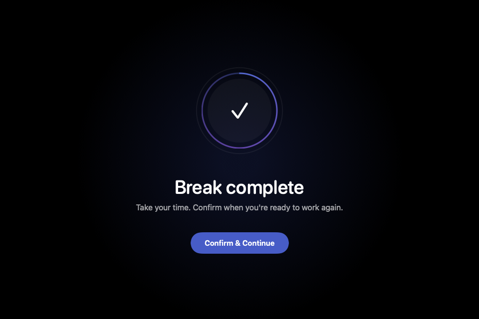
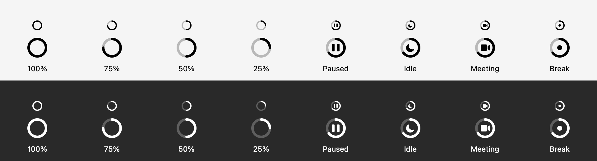

<div align="center">
  
  <h1>Repose Ring</h1>
  <p><strong>A graphical countdown for your next screen break.</strong></p>
  <a href="https://github.com/codievilky/repose/releases/latest">
    
  </a>
  <p><sub>Free and open source. Release download: Apple Silicon, macOS 13+.</sub></p>
</div>

<br/>

<div align="center">
  
</div>

<br/>

Repose Ring is a fork of [Repose by Fikri Karim](https://github.com/fikrikarim/repose),
with a compact graphical menu-bar countdown and improved meeting-pause recovery.
The original author and MIT license are retained.

The ring shrinks as your work interval runs out. Its center shows pause bars for
manual pauses, a moon for idle time, a video camera for meetings, and a dot during
breaks. Hover for the exact time, or click for the existing settings menu.



Repose Ring dims your screens when it's time to rest. Camera or microphone activity
automatically pauses reminders; no calendar setup is required. Audio capture is a
meeting heuristic, so other recording apps can also pause reminders.

## How it works

1. Set your work interval (5–60 min) and break duration (20 sec–5 min)
2. A shrinking ring appears in your menu bar; hover to see the exact countdown
3. When time's up, your screen dims with a gentle reminder to look away
4. If you're on a call, the timer pauses automatically until you're done
5. If you step away from your computer, the timer pauses and resets when you return
6. Locking the screen pauses work; unlocking resets the full work interval
7. A finished break stays black until you click **Confirm & Continue** (or press Enter / Esc)

<div align="center">
  
</div>

Everything is in the menu — pause, resume, restart, all settings. No separate preferences window.

## Why the meeting detection actually works

Most break apps check your calendar or look for specific apps running. Both break easily — your calendar doesn't know about the impromptu call your manager just started, and "Zoom is open" doesn't mean you're in a meeting.

Repose checks the hardware directly. It uses CoreMediaIO to detect active cameras and CoreAudio for microphones. If something is using your camera or mic right now, you're probably in a call, so it backs off.

Camera/microphone detection is app-independent. Meeting-state regressions are
covered by deterministic tests; the latest FaceTime hang-up fix still needs
validation in a real call.

## Smart idle detection

Repose also detects when you've stepped away from your computer. If there's no keyboard or mouse activity for 5 minutes, the timer pauses — and resets to a full work cycle when you return, since you already took a real break.

It's smart about passive screen use too: if you're watching a video (where apps keep the display awake), the timer keeps running so you still get break reminders.

## Install

### Local ring variant

This checkout replaces the menu-bar text countdown with a compact monochrome
ring. The ring shrinks as time runs out and holds its position while paused.
The center shows pause bars for manual pauses, a moon for idle time, a video
camera for meetings, and a dot during breaks. Hover for the countdown or pause
status; the existing menu remains available.

On macOS 14.2+, microphone detection checks active audio input per process,
and requires an actual hardware microphone input. System-audio-only capture and
virtual loopback devices do not count as meetings. The menu and hover text name
the detected microphone app or camera when available.
Codex voice-input processes are excluded from microphone-based meeting detection.
Browser microphone use is also excluded by default so ChatGPT voice and web
dictation do not pause the timer. CoreAudio identifies the browser process, not
the recording tab; Repose does not read browser tabs, URLs, or chat content.
For audio-only web meetings, enable **Include Browser Microphones** under
**Pause During Meetings** in the menu. This includes all microphone use in
recognized browsers, including ChatGPT voice. Camera activity and microphone
capture in native meeting apps still pause reminders automatically.
Meeting activity is polled every second; ending capture or disabling Pause
During Meetings releases the pause. macOS 13–14.1 retains the device heuristic.

Completed breaks stay opaque black with **Confirm & Continue**, even after sleep,
unlock, or new audio activity. Confirmation starts a full new work interval.
Manual pauses stay paused after unlocking. An unfinished break can still be
skipped with Esc when **Allow Skip Break** is enabled. Once the break is complete,
Enter and Esc both confirm even when early skipping is disabled. Held-key repeats
cannot automatically confirm as the countdown ends.

Run deterministic meeting-state regressions with `bash scripts/test-meetings.sh`
(the same `REPOSE_SDK_PATH` override described below applies).

For troubleshooting, `~/Library/Application Support/Repose Ring/status.json`
contains the running app version, timer state, and detected capture source. This
local status contains no audio, images, or screen content and is not uploaded.

To build with macOS Command Line Tools (no full Xcode or dependencies required):

```sh
bash scripts/build-local.sh
open "${TMPDIR:-/tmp/}repose-ring-build/Repose Ring.app"
```

If a macOS 27 Command Line Tools SDK reports a missing `SwiftUIMacros` plugin,
select an installed older SDK, for example:

```sh
REPOSE_SDK_PATH=/Library/Developer/CommandLineTools/SDKs/MacOSX26.5.sdk bash scripts/build-local.sh
```

Build artifacts and a portable ZIP are written to the temporary build directory
printed by the script. Set `REPOSE_BUILD_DIR` to override it; avoid iCloud-managed
folders when signing an app bundle.

The script creates a separately identified **Repose Ring** app with upstream
updates disabled so they cannot overwrite this modification. Quit the official
Repose before opening this build to avoid duplicate reminders. This local build
uses its own preferences; configure your intervals from its menu.

### Download

[Download the latest ZIP](https://github.com/codievilky/repose/releases/latest),
unzip it, and drag **Repose Ring.app** to Applications. The published binary is
for Apple Silicon (M-series) Macs running macOS 13 or later.

Personal builds are ad-hoc signed, not Apple notarized. On first launch, macOS
may require approval in System Settings → Privacy & Security. Upstream automatic
updates are disabled in the packaged fork so they cannot replace this variant.

### One-click updater (free)

Download **Repose-Ring-Updater.zip** from the release assets, unzip it, and run
**Repose-Ring-Update.command**. The script fetches
the latest release from `codievilky/repose`, checks its SHA-256, code signature,
bundle identity, version and architecture, then backs up and replaces only
**Repose Ring.app**. It preserves preferences and restarts the app. It uses only
built-in macOS tools; Python and Xcode are not required.

After verification, the script removes **only this app's** `com.apple.quarantine`
download marker. It does not disable Gatekeeper globally or clear other apps'
attributes. This is a local exception for this personal build, not Apple
notarization or a guarantee of safety. Backups are retained in
`~/Library/Application Support/Repose Ring/Backups`.

The updater itself may need one-time approval on another Mac; reuse that same
script for later app releases. You can also invoke it explicitly from Terminal:

```sh
/bin/bash "$HOME/Downloads/Repose-Ring-Update.command"
```

For an integrity-only check, append `--check-only`; it does not install, launch,
or remove quarantine. Offline use accepts `--package ZIP --checksum SHA256SUMS.txt`.
Developers can run the install/rollback regressions with:

```sh
python3 Tests/test_updater.py /path/to/Repose-Ring-VERSION-AppleSilicon.zip
```

### Upstream Xcode project

For this fork's packaged variant, use `scripts/build-local.sh` above. The original
Xcode project is retained for upstream development (Xcode 15+, Sparkle dependency):

```
git clone https://github.com/codievilky/repose.git
cd repose
brew install xcodegen
xcodegen generate
open Repose.xcodeproj
```

Requires Xcode 15+ and macOS 13+.

## License

MIT. Original copyright © 2026 Fikri Karim; see [LICENSE](LICENSE).
